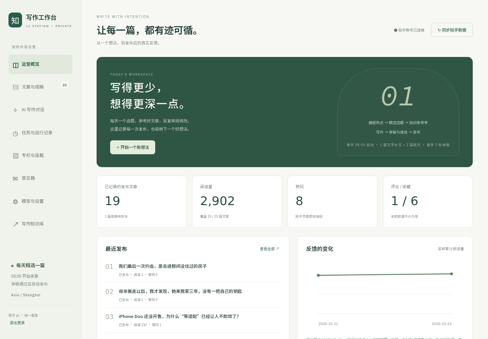
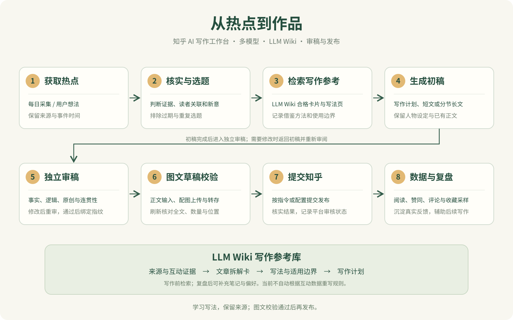
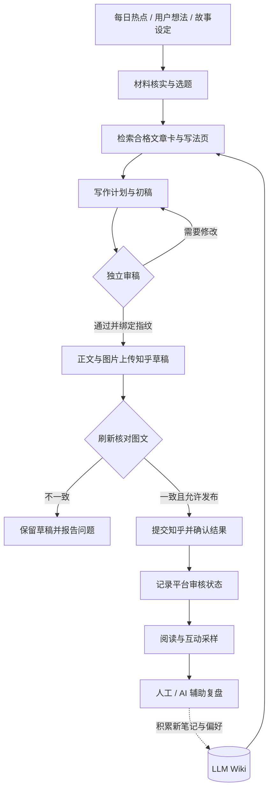
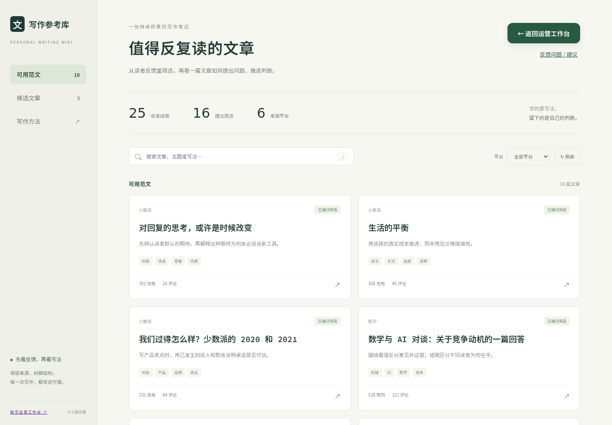
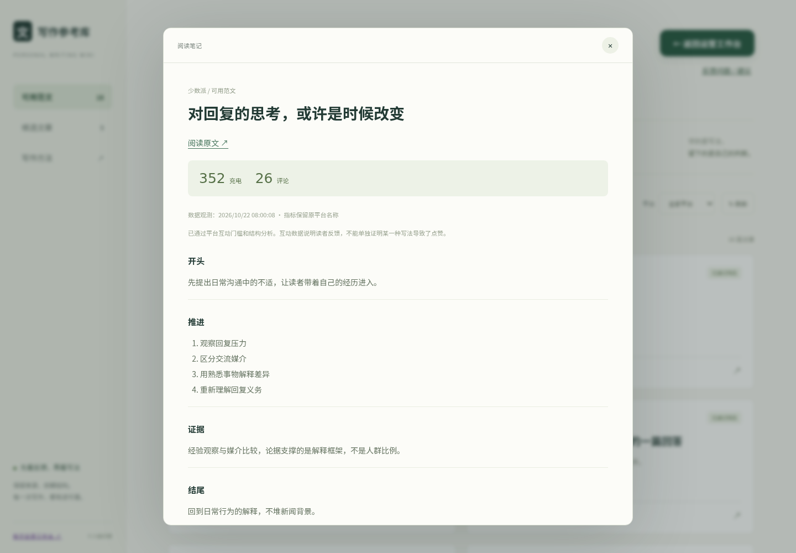
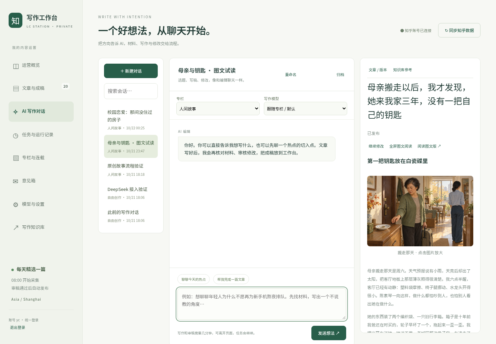

<div align="center">

# 知乎 AI 写作工作台

**让一次灵感，走完选题、参考、写作、审稿、配图、发布和复盘。**

自托管 · 多模型 · 流式对话 · LLM Wiki 写作参考库 · 知乎图文发布

[功能预览](#功能预览) · [写作流程](#从热点到发布) · [LLM Wiki](#llm-wiki-怎样参与写作) · [部署说明](docs/DEPLOYMENT.md) · [看看实际作品](#看看实际作品)

</div>



## 这是一个什么项目？

这是一个部署在自己服务器上的 **AI 内容创作与知乎运营工作台**。你可以在网页里和 AI 讨论想法、选择模型、参考优秀文章的写法，生成长短文或原创故事，再经过审稿和图文检查发布到自己的知乎账号。

它也能在早、中、晚三个时段随机发布短文，每日精选三篇热点，优先娱乐和民生，通过不同角度避免同质化，结合知识库完成选题、写稿和独立审阅；在材料充分、审稿通过且配置允许时提交发布。发布后，工作台继续记录文章和知乎实际反馈，方便回看自己写了什么、哪里有问题、下一篇可以怎样改。

项目由一个实际使用中的个人写作流程逐步搭建而来，包含 Python 服务、原生网页、浏览器自动化和持久化 Markdown 知识库。**仓库提供代码、部署配置、参考笔记和界面截图，不分发作者已写的文章全文、数据库、登录凭据或浏览器登录资料。**

## 它有什么用？

- **把写作集中到一个页面。** 选题、对话、成稿、版本、审稿结果和发布状态可以一起查看，不用在零散脚本和聊天记录里找内容。
- **给模型一套可检索的写作参考。** 不只让 AI 描述热点，也让它说明借鉴哪篇文章的什么写法、如何迁移、哪些内容不能照搬。
- **让长文写作能够分节进行。** 保存提纲、人物约定、已有章节和断点；合并后再审阅整篇，避免一次生成截断，或逐章写作时不断重复。
- **把发布前后的状态记录下来。** 草稿保存、图文校验、提交发布、知乎审核、阅读与互动采样各自有记录。
- **减少反复操作。** 支持定时运行、网页登录、图文阅读、模型切换、草稿回收站和带截图的意见箱。

适合希望自己掌握服务器、内容和账号的个人创作者，也适合作为一个从 AI 写作走到实际发布的工程参考。它不是知乎官方工具，也不承诺文章会获得特定阅读量或互动。

## 访客展示页

[在线参观 →](https://lcstation.top/studio/guest/)

无需管理员账号即可浏览已发布作品、配图大图、写作参考卡，以及从热点发现、资料核实、Wiki 检索到审稿发布的六步流程。页面提供作者知乎主页入口，登录页和管理侧栏也能进入展示页。

访客为匿名只读模式，不创建管理会话，不开放 AI 调用、生成、发布或修改操作。服务端使用独立白名单接口，仅返回已发布且有知乎文章链接的作品，以及符合当前筛选规则的参考卡摘要；草稿、聊天、内部路径、原始证据与账号配置不公开。作品取消发布状态后，其访客正文和配图接口随即停止访问。没有本地正文的历史作品提供知乎原文入口。

自托管时，`/studio/guest/` 及 `/studio/api/guest*` 是公开展示入口，请按自己的内容公开需求配置反向代理；作者主页在 `studio/guest.py` 和 `studio/guest.html` 中设置。访客模式不会开放原来的管理 Wiki 页面。

## 从热点到发布



上图由 GPT 绘制为可编辑 SVG，文字和流程按实际实现整理；对应源码在 `scripts/draw_workflow.py`，也提供下面的 Mermaid 版本。

1. **获取材料。** 每日在早、中、晚三个随机时段发布热点短文，优先娱乐、民生；事件解释、人物观察、争议分析按材料选择，不固定写批判文章。观点稿检索真实讨论并区分评论、媒体转述与作者观点；高赞不等于多数人的共识。虚构故事明确标注，常青题不强套新闻时效。用户可在聊天中指定题材。
2. **核实与选题。** 确认发生了什么、时间和事实边界，比较读者关联与讨论价值，避开近期重复选题。
3. **参考 LLM Wiki。** 刷新可核实的互动证据，检索主题和读者处境相近的合格卡片，阅读写法及适用边界，留下写作计划。
4. **生成初稿。** 短文直接完成；长文按提纲分节，持续带入完整人物设定与已完成正文。图片在已有图像能力或图床素材就绪后加入稿件。
5. **独立审稿与修改。** 另起审稿运行，检查事实、逻辑、原创性、前后连贯和表达，可单独指定审稿模型。失败保留稿件，通过结果与最终文章指纹绑定。
6. **保存并核验图文草稿。** 在知乎编辑器输入正文、按位置上传图片，保存后刷新，对照全文、图片数量、图片标识和段落位置。
7. **提交发布。** 按配置或明确指令提交，再通过创作中心或发布编辑器确认结果。“内部审稿通过”和“知乎审核通过”分别记录。
8. **观察实际反馈。** 同步阅读、赞同、评论、收藏等可取得的数据，用于后续复盘。当前会保存采样和笔记，尚不自动根据互动数据重写知识库规则。

<details>
<summary>展开可编辑的 Mermaid 流程图</summary>



</details>

## LLM Wiki 怎样参与写作？

这里的 LLM Wiki 是一套**有来源、可链接、能更新的写作笔记**：模型每次写作都能查到文章拆解、通用写法和使用边界，而不是只收到一句“请模仿高赞文章”。它使用 JSON 记录和 Markdown 页面，不需要先部署向量数据库。

### 先筛选读者反馈，再分析文章

每篇候选保留原文链接、平台、互动指标原名、观测时间和证据。不同平台使用各自的门槛，例如知乎的赞同、少数派的充电不能直接混排为一个热度榜。

达到互动门槛之后，还需要确认读过全文并完成结构分析。数据未知、证据过期、正文未读或分析未完成的条目留在候选区，不直接提供给自动写作。

高互动是筛选线索，不是文章一定优秀的证明。卡片会区分“可能为什么引起共鸣”的编辑判断与真正核实到的数据，不把推测当成因果结论。

### 把“写得好”拆成能使用的笔记

文章卡记录开头如何进入、正文怎样推进、证据和反例如何安排、结尾怎样收束，以及具体的迁移建议。跨文章共通的方法，再归纳到写法页：例如观察与重新解释、读者体验、反方与边界。

最重要的是同时记录 **可以借的方法** 和 **不能借的故事、人物、句子、旧事实**。检索结果用于形成自己的文章，不把范文换几个词重新发布。

### 每次写作都留下迁移记录

检索以中文二元/三元词组和英文词为基础，综合文章主题、读者处境和结构分析进行相关性排序。它是本地词法检索，不是向量检索。

初稿需要输出至少两篇当前合格参考卡的 ID、借鉴点和具体迁移方式，并写明提纲、主要判断、反方意见和事实边界。程序会检查这些记录和卡片当前资格；材料不足时停止，不靠虚构参考继续写作。

```text
公开来源与互动证据
       ↓
文章拆解卡 ←→ 通用写法页 ←→ 读者偏好
       ↓
检索：主题 + 读者处境 + 核心冲突
       ↓
写作计划：学什么、怎么迁移、哪些不能借
       ↓
初稿 → 独立审稿 → 成稿与发布记录
```

详细规则与数据结构见 [`writing-wiki/README.md`](writing-wiki/README.md) 和 [`policy.json`](writing-wiki/policy.json)。仓库只附公开文章的来源与分析笔记，不镜像其全文。互动证据有时效，部署后应重新刷新。

## 功能预览

以下均来自作者实际部署，数据是截图当时的采样。截图中的文章局部只用于展示阅读效果，全文不作为仓库文件提供。

### 写作参考库：从来源进入具体写法



可以按平台筛选，区分合格范文与候选文章，查找文章主题与写法。



拆解卡同时展示结构分析、互动证据和适用限制，便于判断这篇参考是否适合当前选题。

### AI 写作对话：想法、文稿与参考放在一起



支持多会话、模型选择、专栏上下文、流式回复、处理进度展开/折叠，以及失败后重新发送。网页展示的是公开处理记录，不透出模型私有推理。

### 图文阅读：长文、插图与全屏查看

示例作品：**《母亲搬走以后，我才发现，她来我家三年，没有一把自己的钥匙》**。


章节目录、图文排版、全屏阅读和图片放大都可以在工作台直接使用。

<details>
<summary>查看手机阅读截图</summary>


</details>

### 其他已实现能力

| 模块 | 当前能力 |
| --- | --- |
| 运营概览 | 文章数量、可取得的阅读与互动统计、累计采样曲线 |
| 模型设置 | 本机 Codex、已验证的 DeepSeek、兼容服务配置与模型路由 |
| 专栏与连载 | 科技观察、原创故事等定位、风格、设定和模型选择 |
| 成稿管理 | 版本保留、本地草稿删除与恢复、已发布内容保护 |
| 任务记录 | 持久化排队、过程与错误查看、已有发布凭证核对 |
| 图文发布 | 图床图片下载与校验、编辑器转存、全文和图片位置核验 |
| 意见箱 | 文字、Ctrl+V 粘贴截图、立即/凌晨排期、撤回 |
| 项目修复 | 可选 Codex 修复 worker、项目范围内提案、检查、部署与撤销 |
| 登录与通知 | 工作台和 Wiki 统一登录；知乎扫码登录；配置后的邮件通知 |

## 看看实际作品

欢迎到作者的知乎账号看看最终文章的效果，也欢迎比较工作台的图文阅读与知乎成稿。

- [知乎账号主页](https://www.zhihu.com/people/shuai-ge-8-87-44)
- [《母亲搬走以后，我才发现，她来我家三年，没有一把自己的钥匙》](https://zhuanlan.zhihu.com/p/2096391978611229007)
- [《我们最后一次约会，是去退那间没住过的房子》](https://zhuanlan.zhihu.com/p/2096396880624333248)

作品由模型生成与后续编辑共同完成，配图由 AI 生成。这些链接用于展示创作流程的实际结果，不作为阅读量或收益承诺。在线工作台是作者的私人部署，不提供公开管理账号。

## 本地部署

```bash
git clone https://github.com/1BTU/zhihu-ai-studio.git
cd zhihu-ai-studio
python3.11 -m venv .venv
.venv/bin/pip install -r requirements.txt
npm ci
cp .env.example .env
.venv/bin/python scripts/init_local.py
```

然后设置自己的 HTTPS 域名、模型和热点采集依赖，导出 Wiki 并启动服务。完整步骤、Nginx/systemd/cron 模板、图床和邮件设置见 **[部署说明](docs/DEPLOYMENT.md)**。

初始配置关闭自动发布和邮件发送。首次初始化不会创建文章，也不会提交到知乎；请使用自己的模型服务、知乎账号和可选邮件连接。

## 项目结构

```text
studio/                 工作台、认证、模型、SSE 对话、任务和反馈
server-site/            写作参考库网页源文件
writing-wiki/           来源索引、拆解卡、写法页、互动证据
runtime.py              域名、可执行文件、外部 Skill 和图床路径配置
daily.py                每日采集、生成、审稿、发布和通知
longform.py             分节长文与全文审稿
wiki.py                 参考库刷新、编译、资格校验与检索
draft*.mjs              知乎文字 / 图文草稿写入
publish.mjs             发布前后核验与提交
article_images.py       图片下载与原图 SHA-256 校验
sync-web.py             导出受登录保护的 Wiki 页面数据
scripts/                首次初始化
deploy/                 Nginx、systemd、定时任务模板
tests/                  审稿、隔离、流程、流式与图片核验测试
docs/                   部署说明、流程图和真实截图
```

## 当前边界

- 这是**单账号工作台**，还不是多租户内容平台。
- 知乎登录、页面结构和账号状态可能变化；短信、验证与平台审核需要按实际页面处理。
- 目标知乎专栏的定向投稿还未完成实账号验证，绑定目标时会停止，不会自动改投默认位置。站内专栏组织与写作定位已经可用。
- 图文上传和校验已经实现；无人值守定时出图尚未接入可调度的图片生成服务。当前示例配图通过交互式 AI 能力生成。
- 新闻采集 Skill、Codex CLI/连接能力、模型服务和可选邮件通道需要自行配置，仓库不附带凭据。当前聊天写作也需要采集脚本准备上下文。
- 数据统计来自可取得的真实平台指标；未知值保留未知，累计采样不是每日新增，也不据此推断点赞原因。
- 自动修复是可选功能，限制在项目源码与版本化部署流程内；普通写作无需启用它。

## 检查与贡献

```bash
.venv/bin/python -m unittest discover -s tests -v
npm run test:images
node studio/repair-smoke.mjs .
```

欢迎通过 Issue 反馈使用问题和改进建议。提交时请去掉 API Key、Cookie、邮箱凭据和个人稿件；描述运行环境、复现步骤和实际错误即可。参考库中的第三方来源与作者保留原链接，文章正文及相关权利仍归原作者。

### 每日运营扩展

- 三篇短文分早、中、晚发布，持久化随机时间，错过时段不集中补发。
- “知乎日常”展示每日发现的活动、圆桌、候选问题及互动结果。
- 回答和提问经过知识库参考与独立审阅，分别保留提交凭据；材料不足可跳过。
- 活动/候选发现已实测，问题页访问限制尚影响回答发布的实账号验证。详情及开启方式见部署说明，示例默认关闭自动互动。

知识库现支持每日发现新文章并由 DeepSeek 总结，独立梗库支持出处、适用场景和流行时间检索。网页显示采集状态；定时器部署见 [部署说明](docs/DEPLOYMENT.md#配置每日知识库采集)。

### 每日素材采集子智能体

`material_agent.py` 是一个有预算上限、独立留痕的采集子智能体：使用 DeepSeek Search 发现资料，Fetch 读取正文，再用配置的 DeepSeek 模型整理梗释义与每日选题简报。它没有发布或账号操作工具。`wiki_collect.py` 每日采集时调用它；现有文章互动门槛保持不变。

- `meme-sites.json` 保存推荐的梗网站，每次检查访问情况，并记录搜索结果日期；不自动宣称网站仍持续更新。
- Wiki 的“梗来源站”和“每日素材”可查看网站状态、新闻背景、写作角度、事实缺口及来源链接。
- 采集记录与模型原始输出保存在私有目录；梗必须能在实际正文中找到对应证据才入库，重复来源不会重复添加。
- 每日写作可读取 `writing-wiki/daily-materials.json`，仍须核验新闻与真实读者讨论，不能把素材简报当作大众观点。
- 默认每次读取最多 9 个梗页面，日素材搜索 3 组，每组 3 条；Search/Fetch 按 DeepSeek 官方价格收费。调用失败会记录，不编造成功数据。
- 默认与知识库一起在北京时间 02:10 运行。手动测试：`python material_agent.py`，与每日采集共用锁。设置 `material_agent_enabled=false` 可暂停每日调用子智能体。

采集异常时会回退到服务器读取公开 HTML。已验证的有梗百科另有独立浏览器读取器（无登录资料，只允许该域名的请求）；该站证书异常会在读取方式里明确标注，仅作词义线索，不证明起源。用途已经变更的网站从公开目录过滤，并从当前采集种子移除；历史检查证据仅留在私有运行记录。

固定梗站优先直接读取网页并提取站内词条链接，不调用搜索。读取失败才尝试备用读取和站内搜索恢复，搜索命中的链接也必须实际读到正文。连续三个不同日期恢复失败的站点自动从来源库和采集种子移除；短暂失败不立即删除。热点发现和寻找新来源仍使用 DeepSeek Search。

固定词典的词条通过 `meme_crawl.py` 直接解析并去重，每站每天最多检查 15 个未收录词条，只保留最多 100 字短摘录、来源与日期，不调用模型。Wiki 的“原始词条”区展示这些资料；它们不会进入自动写作的 `meme_search` 结果。页面缺少正文时跳过，词条发布日期未知时留空。单独运行 `python meme_crawl.py` 可采集一轮，使用与每日任务相同的互斥锁。
